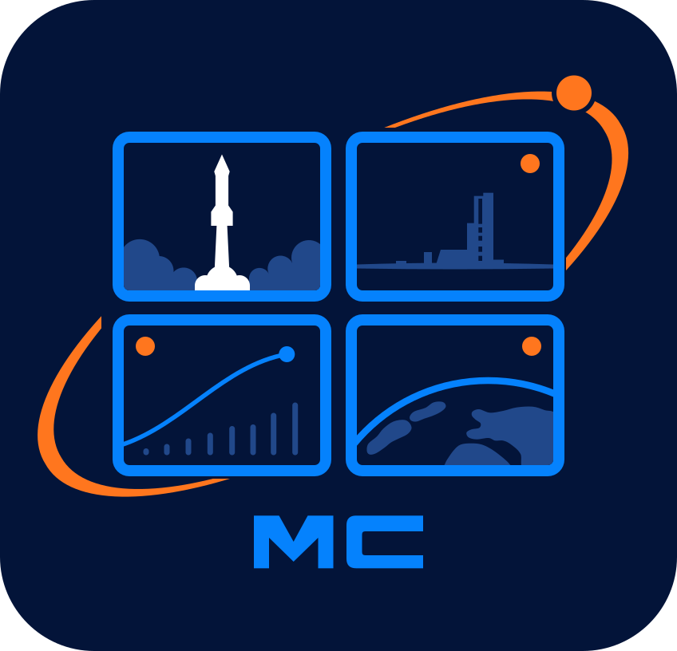

<p align="center">
  
</p>

<h1 align="center">Mission Control Center</h1>

[Abrir online](https://joaooliveira97.github.io/mission-control-center/)

Um centro de controlo para ver vários diretos do YouTube ao mesmo tempo, numa só grelha. Nasceu para acompanhar os lançamentos da Starship com todas as câmaras abertas.

## O que faz

- Cola links de várias plataformas, misturadas na mesma grelha:
  - **YouTube**: `watch?v=`, `/live/`, `/shorts/`, `/embed/`, `youtu.be` ou só o ID do vídeo.
  - **Twitch** e **Kick**: o link do canal (`twitch.tv/nasa`, `kick.com/canal`).
  - **Facebook**: o link de um vídeo ou direto público (`…/videos/…`, `watch/?v=…`, `watch/live/?v=…`).
  - **X**: o link da transmissão (`x.com/i/broadcasts/…`), que mostra só o vídeo com o player de transmissões do X, ou o link de um post (`x.com/conta/status/…`), que mostra o post inteiro. Em ambos o som não pode ser controlado pela página.
- Três disposições:
  - **Grelha**: todos com o mesmo tamanho, com o número de colunas escolhido para aproveitar melhor o ecrã.
  - **Destaque**: um vídeo grande e os restantes numa coluna ao lado.
  - **Palco**: dois vídeos grandes em cima e os restantes em baixo (o antigo "2 + 3").
- Só o primeiro vídeo começa com som. Cada vídeo tem botões para ligar/desligar o som, ouvir só esse, pô-lo em destaque, abri-lo no site original, pô-lo em ecrã inteiro ou removê-lo. No Kick, mudar o som recarrega o player, porque o Kick não tem API para isso.
- Relógio UTC no topo, útil para seguir as contagens decrescentes.
- Os vídeos ficam guardados no browser automaticamente (incluindo os que tinham sido guardados na versão antiga).
- O botão de partilha copia um link com todos os vídeos e a disposição, por exemplo `…/#v=ID1,ID2,ID3&layout=focus`.

## Desenvolvimento

Precisa de Node.js 22.22.3+ ou 24 (ver `.nvmrc`).

```bash
npm install
npm start        # http://localhost:4200
npm test         # testes unitários (Vitest)
npm run build    # build de produção em dist/
```

Feito com Angular 22 (componentes standalone, signals, sem zone.js) e `@angular/youtube-player`.

## Publicação

Cada push para `main` corre os testes e publica no GitHub Pages através do workflow em `.github/workflows/deploy.yml`.
